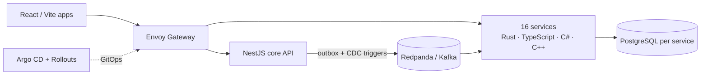

### Hi, I'm Daniil 👋

Backend & platform engineer in Shanghai (UTC+8). I design, build and run
**[StrinovaHub](https://strinovahub.com)**, a live esports platform for the game Strinova:
player profiles built from match replays, tournaments, teams, guides, clips and chat.
695 registered players, 2,200+ ranked matches parsed, a 450-member Discord community.

The platform code is private; this profile holds the parts I've opened up, and I'm happy to walk
through the rest.

**How StrinovaHub is built**

- Split a NestJS / Prisma monolith into **16 services on k3s** behind Envoy Gateway, path by path
  (strangler fig): Rust (axum, tokio, sqlx, rdkafka), TypeScript, C# (ASP.NET Core) and C++.
- **Event backbone**: Kafka with a transactional outbox fed by PostgreSQL change-capture triggers,
  protobuf contracts, idempotent consumers, dead-letter topics, an hourly reconciler.
- **Delivery**: self-hosted Forgejo CI, Argo CD, canary releases gated by Prometheus 5xx/p95
  analysis; Grafana, Tempo and OpenTelemetry for the rest.
- **Performance**: at 100 req/s, p95 387 → 214 ms and p99 1,643 → 470 ms; database connections
  74 → 7.
- **ASH**, an in-memory analytics engine in Rust: 117k page views load in 0.36 s, reports answer
  in milliseconds, with significance tests, anomaly detection and forecasts.
- Also: a C# tournament engine (single/double elimination, Swiss, round robin, GSL), tantivy
  search, a Rust Socket.IO gateway, libvips image processing in C++, Discord and Telegram bots.

**Open source**

- [`ash-stats`](https://github.com/XXVIX/ash-stats): the statistics module of ASH. Wilson intervals, significance
  tests, trend-adjusted anomaly detection and Holt–Winters forecasts for daily metrics.

**Stack**: TypeScript · Rust · C# · C++ · SQL · PostgreSQL · Redis · Kafka · Kubernetes ·
Argo CD · Envoy · Prometheus · React

**Contact**: [LinkedIn](https://www.linkedin.com/in/strinovahub) · whyxxvix@gmail.com ·
[CV](https://cdn.strinovahub.com/reports/daniil-neretin-cv-6415b893ac.pdf)
