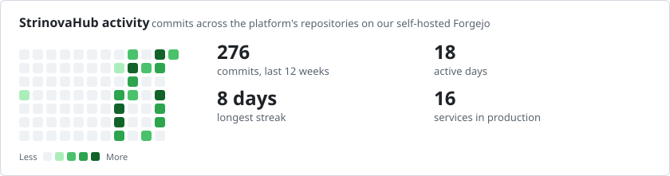
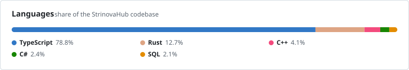

  

  I design, build and run <a href="https://strinovahub.com"><b>StrinovaHub</b></a>, a live esports platform: 
  16 services in Rust, TypeScript, C# and C++ on Kubernetes, joined by Kafka.

  <a href="https://daniilthe.dev">Website</a> &nbsp;•&nbsp;
  <a href="mailto:whyxxvix@gmail.com">Email</a> &nbsp;•&nbsp;
  <a href="https://www.linkedin.com/in/strinovahub">LinkedIn</a> &nbsp;•&nbsp;
  <a href="https://daniilthe.dev/daniil-neretin-cv.pdf">CV</a>

---

## Focus

- **Services that stay up.** Split a NestJS monolith into 16 services behind Envoy Gateway, route by route, while players kept using the platform.
- **Events done properly.** Kafka with a transactional outbox fed by PostgreSQL triggers, protobuf contracts, idempotent consumers and dead-letter topics.
- **Measured performance.** p99 1,643 → 470 ms at 100 req/s; database connections 74 → 7.
- **The whole path to production.** GitOps with Argo CD, canary releases, OpenTelemetry tracing, and the network underneath: WireGuard, private subnets, policy routing.

---

## Open source

- [**ash-stats**](https://github.com/meowdevmoe/ash-stats) — the statistics core of my analytics engine as a Rust crate: Wilson intervals, significance tests, trend-aware anomaly detection and Holt–Winters forecasts.

---

## Tech Stack

### Languages

  
  
  
  
  
  

### Backend

  
  
  
  
  
  
  

### Data & Messaging

  
  
  
  
  

### Infrastructure

  
  
  
  
  
  
  
  

### Observability

  
  
  
  

### Frontend

  
  
  
  

---

##  Stats

<picture>
  <source media="(prefers-color-scheme: dark)" srcset="assets/activity-dark.svg"/>
  
</picture>
<picture>
  <source media="(prefers-color-scheme: dark)" srcset="assets/languages-dark.svg"/>
  
</picture>
<picture>
  <source media="(prefers-color-scheme: dark)" srcset="https://nekodb.space/github/meowdevmoe/languages.svg?theme=dark"/>
  
</picture>

---

  

